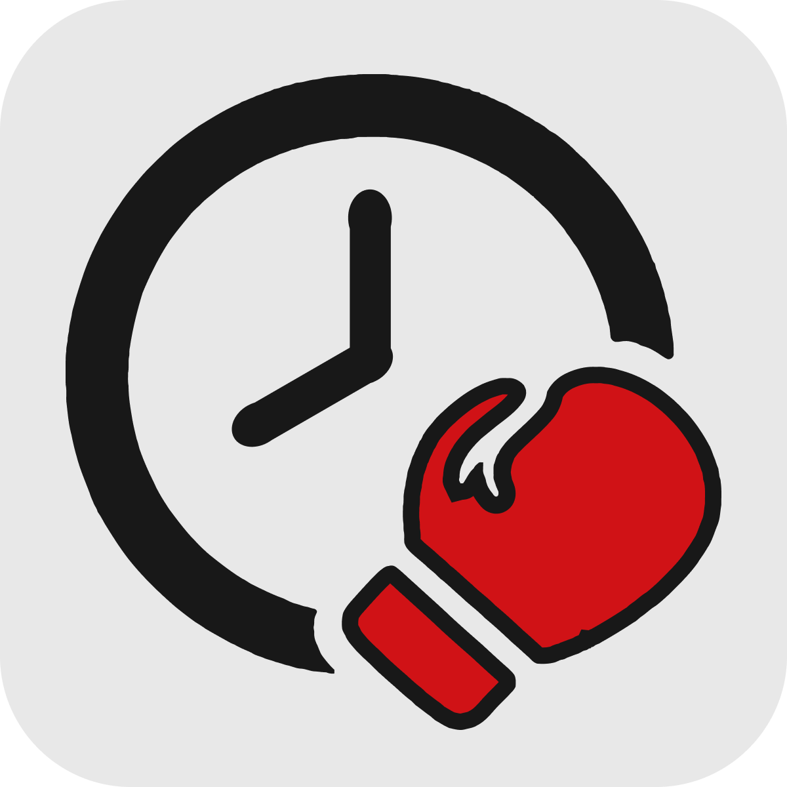

<h1 align="center">UFC Alarm</h1>

  

  
  

  Alarme pra lutas específicas do UFC — sem precisar ficar checando o card manualmente.

Monorepo com três projetos que, juntos, avisam quando uma luta específica do
UFC está começando — por alarme sonoro no navegador (web) ou push no celular
(mobile), sem precisar ficar checando o card manualmente.

- [`ufc-alarm-middleware`](ufc-alarm-middleware) — proxy único que fala com a
  [Cito API](https://citoapi.com/ufc-api/), cacheia as respostas e esconde a
  chave real dos demais serviços.
- [`ufc-alarm-front`](ufc-alarm-front) — app web em Next.js: lista de
  eventos/lutas, conta de usuário, alarme sonoro na página e o worker que
  dispara push pro mobile.
- [`ufc-alarm-mobile`](ufc-alarm-mobile) — app Android (Flutter) sem conta de
  usuário, que recebe push via Firebase Cloud Messaging e toca o alarme
  mesmo com o app fechado.

Cada um tem seu próprio README com detalhes de arquitetura e decisões de
projeto — comece por eles depois de ler o setup abaixo.

## Status do projeto

Este projeto está sem uso ativo (a conta usada para consumir a Cito API
teve o IP bloqueado por excesso de requisições) e foi aberto como open
source para quem quiser reaproveitar, aprender com o código ou continuar o
desenvolvimento. Pra rodar de verdade você vai precisar da sua própria
chave da Cito API (e, se quiser o app mobile com push, do seu próprio
projeto Firebase) — nada disso vem incluído no repositório.

## Setup

Os três projetos são independentes entre si, mas o front e o mobile
dependem do middleware já estar rodando. Ordem sugerida:

1. **`ufc-alarm-middleware`**: crie uma conta na
   [Cito API](https://citoapi.com/ufc-api/) (free tier: 500 req/mês), copie
   `.env.example` para `.env` e preencha `CITO_API_KEY` e
   `MIDDLEWARE_INTERNAL_KEY` (gere com `openssl rand -hex 32`). Detalhes em
   [`ufc-alarm-middleware/README.md`](ufc-alarm-middleware/README.md).
2. **`ufc-alarm-front`**: copie `.env.local.example` para `.env.local`,
   aponte `CITO_MIDDLEWARE_URL` pro middleware do passo 1 e use a mesma
   chave em `CITO_MIDDLEWARE_INTERNAL_KEY`. Push mobile via Firebase é
   opcional — veja a seção "Setup do Firebase" no README do mobile. Detalhes
   em [`ufc-alarm-front/README.md`](ufc-alarm-front/README.md).
3. **`ufc-alarm-mobile`**: só necessário se for rodar o app Android.
   Detalhes em [`ufc-alarm-mobile/README.md`](ufc-alarm-mobile/README.md).

## Licença

[MIT](LICENSE).
